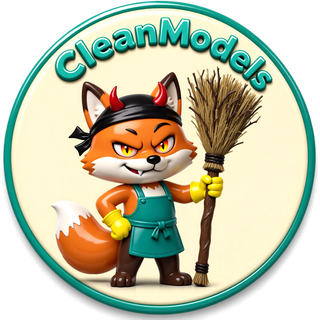
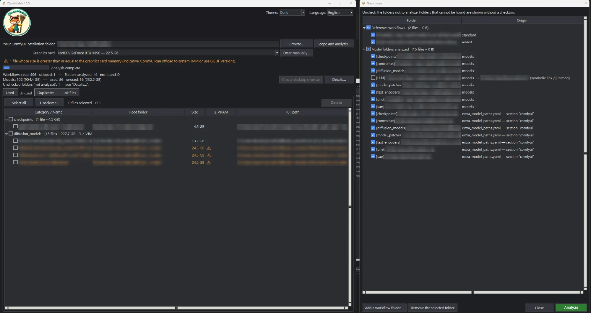

<p align="center"></p>

# CleanModels

Desktop tool to clean up your ComfyUI models:

- **Used**: models referenced by your workflows, with the number of calls and workflows;
- **Unused**: models that no workflow references;
- **Duplicates**: files with identical content (search on demand);
- **Junk files**: incomplete and temporary downloads (`*.part`, `*.crdownload`, `*.tmp`, `*.download`, editable patterns).

Reference workflows: `<ComfyUI>/user/default/workflows/`, plus any workflow folders you add in
the application (remembered, removable).
Folders analyzed: `<ComfyUI>/models/` and the paths declared in `extra_model_paths.yaml`
(symbolic links and junctions included), limited to
`checkpoints`, `controlnet`, `diffusion_models`, `LLM`, `model_patches`, `text_encoders`, `unet`, `vae`.

The “Scope and analysis…” button opens the “Check scope” window: it shows the reference workflow
folders and the model folders that will be examined, with their origin and the real target of
links. Everything is checked by default; uncheck the folders you do not want to analyze, then
click “Analyze”. An unchecked workflow folder is still read again before each deletion: a model it
uses cannot be deleted.

At startup, the main window opens on the left of the screen and the “Check scope” window on its
right; it stays open after the analysis.

Top right of the main window: **Theme** (Light / Dark) and **Language** (Français / English /
Deutsch). Both choices are remembered; the log file stays in French.

**Graphics card**: its memory is read automatically (nvidia-smi, otherwise the Windows registry);
choose the reference card or enter the value manually. Files whose size is greater than or equal
to that memory are marked ⚠ and shown in orange (indicative only).

## How duplicates are detected

Duplicates are detected by **content**, not by name: two files with different names in different
folders are still found, and two files with the same name but different content are not flagged.

1. **Size first**: files are grouped by exact size in bytes. A file with a unique size cannot have
   a duplicate, so it is skipped without being read.
2. **SHA-256 hash**: only files sharing the same size are fully read (in 8 MB chunks) and hashed.
   Same hash means identical content, byte for byte.

- The same physical file reached through a symbolic link, a junction or a hard link is counted
  once and never reported as a duplicate.
- Hashing multi-GB models takes time, so the search only runs when you click **Find duplicates**,
  with a progress bar and a **Cancel** button.
- Each copy shows whether a workflow references it, and CleanModels refuses to delete every copy
  of a group: at least one copy is always kept.

## ⚠ Permanent deletion

Deleted files do **not** go to the Recycle Bin. Every deletion requires explicit confirmation,
is checked again just before acting, and is recorded in the log
`%APPDATA%\CleanModels\cleanmodels.log`.

<p align="center"></p>
<p align="center"><em>Main window (Unused tab, dark theme) and the “Check scope” window. Paths and model names are blurred.</em></p>

## Requirements

- Windows 10 or 11.
- [Python 3.10 or later](https://www.python.org/downloads/). During installation, tick **"Add Python to PATH"** and keep the **"tcl/tk and IDLE"** option checked (it provides the windows used by CleanModels; it is checked by default).
- [Git](https://git-scm.com/download/win), only for the installation with Git (option 1 below).

CleanModels uses only the Python standard library: there is nothing else to install.

## Installation

### Option 1: with Git

Open a **Command Prompt** (`cmd`) in the folder where you want CleanModels, then run:

```bat
git clone https://github.com/marche-obscure/CleanModels.git
cd CleanModels
run_cleanmodels.bat
```

### Option 2: without Git

1. On this page, click **Code**, then **Download ZIP**.
2. Extract the zip anywhere on your PC.
3. Double-click **`run_cleanmodels.bat`** in the extracted folder.

### First launch

Nothing is downloaded or installed: CleanModels starts immediately. On the very first launch, it offers to create a **CleanModels shortcut on the desktop** (asked only once, whatever the answer). You can create it later with the **Create desktop shortcut** button at the top of the main window; the button is greyed out when the shortcut already exists (checked when CleanModels starts). The main window opens on the left of the screen and the “Check scope” window on its right. Enter your ComfyUI installation folder (or click **Browse…**), check the folders to analyze, then click **Analyze**.

If the launcher reports an error, you can start CleanModels by hand in a Command Prompt opened in the CleanModels folder:

```bat
py -3 -m cleanmodels
```

If `py` is not recognized, Python is not installed or was installed without the launcher: reinstall it from python.org with the options above.

### Update

With Git, from the CleanModels folder:

```bat
git pull
```

Without Git, download the new zip and extract it over the old folder. Your settings (ComfyUI folder, added workflow folders, graphics card, theme, language) are stored in `%APPDATA%\CleanModels\settings.json` and are kept.

CleanModels starts in French. You can change the language (Français, English, Deutsch) and the theme (Light / Dark) at any time with the selectors in the top-right corner of the main window; there is no question at startup.

## Images

The logo and the icon are generated from `assets/source/` by `tools/make_assets.py`. This
developer tool needs [Pillow](https://pypi.org/project/pillow/); the application itself does not.

## Tests

```bash
py -3 -m unittest discover -s tests -v
```

## Documentation (in French)

- Specification: `docs/specs/2026-10-10-cleanmodels-design.md`
- Implementation plan: `docs/superpowers/plans/2026-10-10-cleanmodels.md`

## License

The source code is released under the [MIT License](LICENSE).

The images in the `assets` folder (CleanModels logo, mascot and icon) are **not** covered by the
MIT License: © 2026 marche-obscure, all rights reserved. They may not be reused, modified or
redistributed separately from CleanModels without permission.
